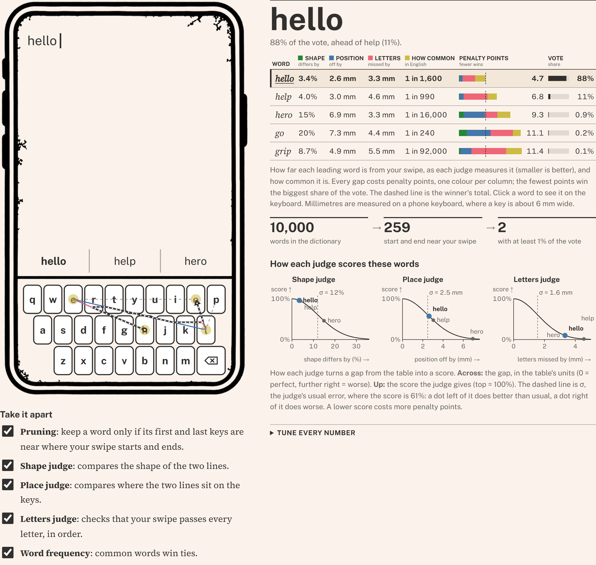
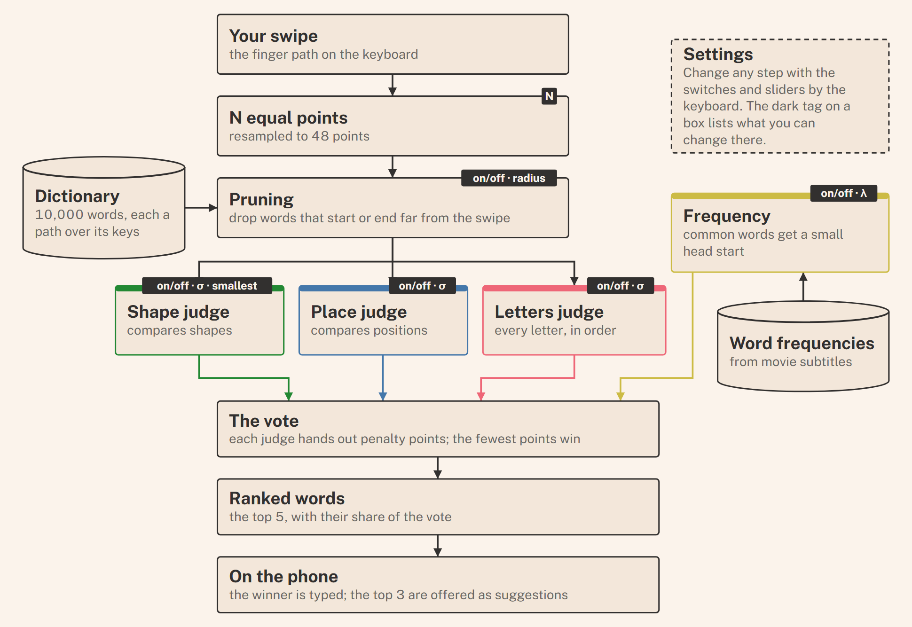
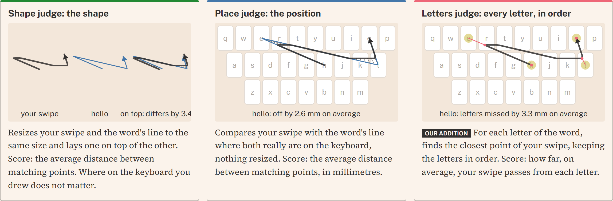
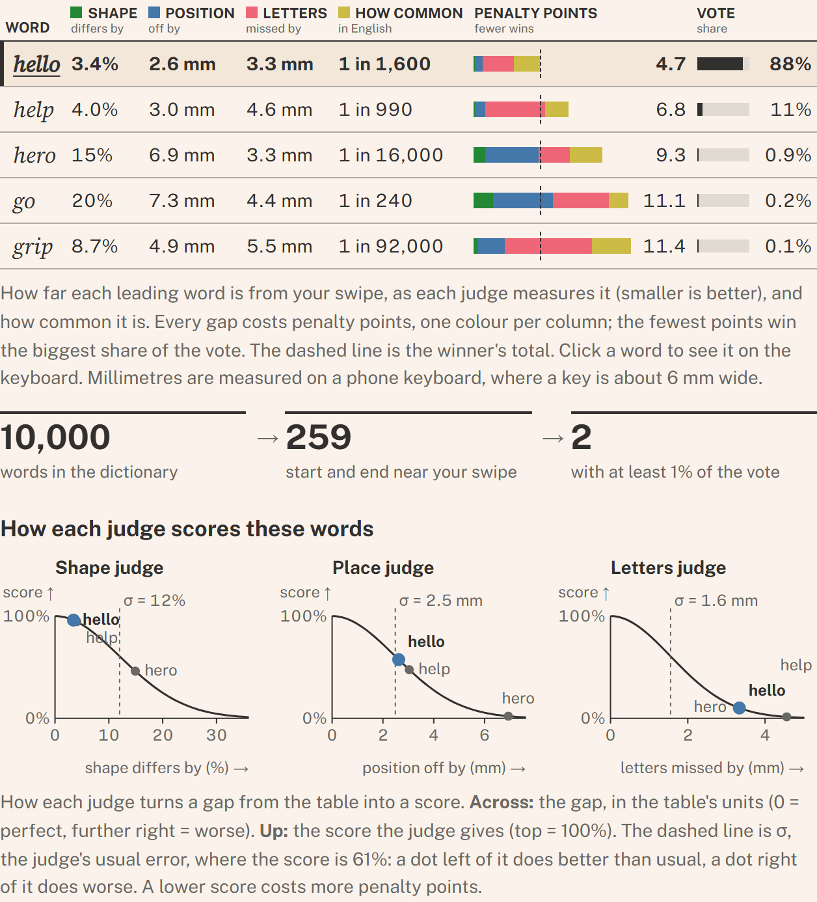
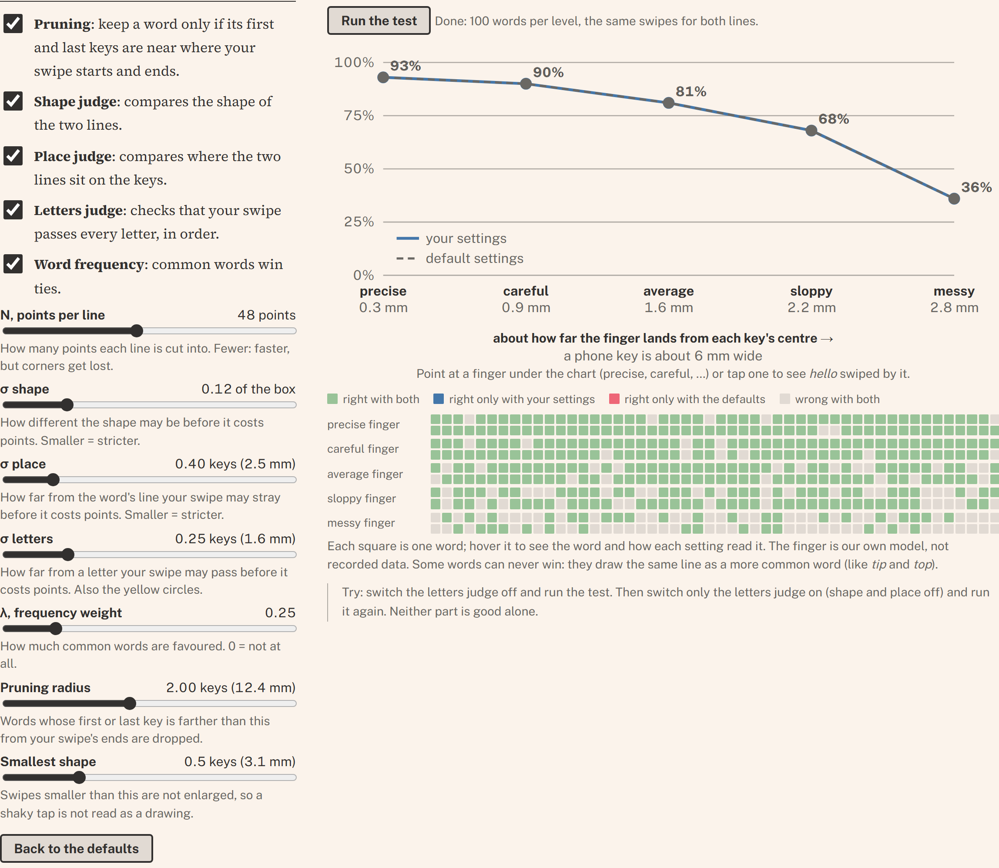
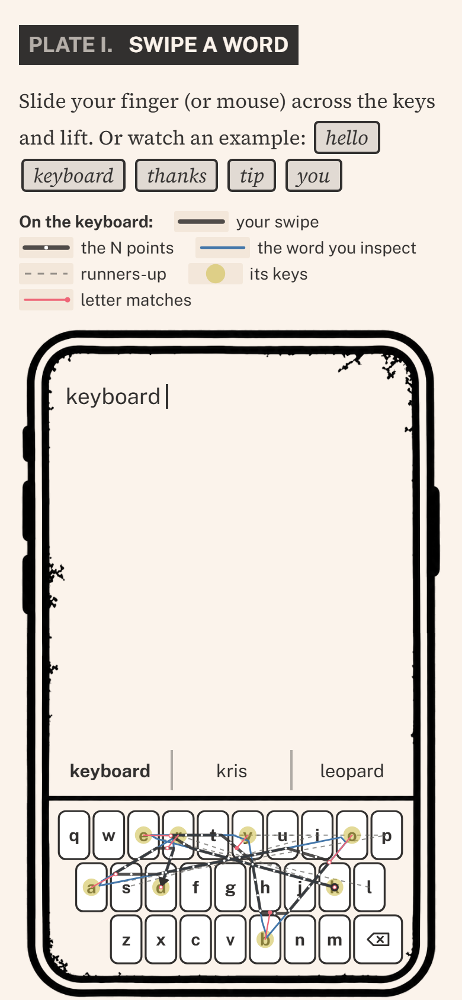

# Your finger never taps the word. It slides.

**Swipe typing, taken apart.** When you swipe across a phone keyboard, the phone never works out which letters you crossed. It compares your whole line with the ideal line of every word it knows (10,000 here) and holds a vote. This page lets you swipe, watch the vote, and take the machine apart: switch every part off, move every number, and measure the effect.

Built for the Global Virtual Hackathon 2026. Plain JavaScript in ES modules, HTML and CSS. No framework, no library, no build step, no server code, no API key.

- Live: https://swipe-typing-taken-apart.vercel.app
- Code: https://github.com/akira113p/swipe-typing-taken-apart

## What it looks like

Swipe on the phone (or press an example). The winner is typed and the vote is shown on the right, in one table. Each row is a word: how far each judge finds it from your swipe (in % and in mm on a phone), how common it is, the penalty points each judge charged (one colour per judge, the fewest points win) and its share of the vote. Under it, the funnel counts how many of the 10,000 words survive each step, and the bell curves show how each judge turns a gap into a score.



*How it decides* starts with the whole pipeline. The dark tags name the switches and sliders that change each step.



Each judge is drawn on your own swipe, recomputed on every swipe and every slider move.



The vote table up close. The dashed line in the penalty column is the winner's total: the part of a bar past it is how far that word fell behind.



*Your settings against the defaults*: a simulated finger swipes 100 random words at five levels of sloppiness, read with your settings and with the defaults. Each square is one word. Point at a level to see *hello* swiped by that finger.





## Try it

```
python serve.py        # then open http://localhost:8000
node --test            # 24 tests, Node 24, no dependencies
```

You need Python 3 (no packages) to serve the page and Node 24 only for the tests. Open the page through the server, not by double-clicking `index.html`: browsers refuse to load ES modules from `file://`.

`serve.py` is `python -m http.server` plus a header that stops the browser reusing old files, so edits show up on reload. Any static server works (`python -m http.server` too), including GitHub Pages.

1. **Swipe a word** on the keyboard inside the phone, or press one of the example buttons (*hello*, *keyboard*, *thanks*, *tip*, *you*). No microphone or camera is needed.
2. **Read the vote.** The winner, the leading words with every judge's gap and penalty points, and how many of the 10,000 words survived each step appear next to the phone. Click a word to draw it on the keyboard.
3. **Take it apart.** Switch any judge off, or open *Tune every number* and move a slider. The vote redraws at once.
4. **Measure it.** *Run the test* scores your settings against the defaults on simulated swipes of random dictionary words.

## How it works

| Step | What happens | Code |
|---|---|---|
| Lines | Every word becomes straight segments between its key centres | `core/path.js`, `core/templates.js` |
| Resample | Swipe and words become N evenly spaced points | `resample` in `core/path.js` |
| Prune | Words whose first or last key is far from the swipe's ends are dropped | `core/recognizer.js` |
| Shape judge | Average point-to-point distance after scaling both lines to the same box (SHARK², eq. 1–2) | `core/shape.js` |
| Place judge | The same distance on the real keys | `core/judges.js` |
| Letters judge (ours) | Each letter finds its own spot on the swipe, in order, first and last pinned; dynamic programming | `core/letters.js` |
| Vote | Each gap costs ½(gap/σ)² penalty points, rare words pay −λ·ln P(word); share ∝ e^−points | `core/vote.js` |

The recognizer receives only the swipe's points, never anything from the page.

## What is computed and what is drawn by hand

Every line, number, chart and vote is computed in the browser by our code from the swipe and the settings. The phone frame (`img/phone-frame.png`) and the colours are decoration. The figure under the title is computed: the keys a straight *hello* passes over come from `core/crossed.js` (checked by a test), and CSS only animates the line drawing itself in. What appears on the phone is computed: each swipe writes the vote's winner followed by a space, and the bar above the keys shows the three words with the most votes (`ui/notepad.js`). Tapping a suggestion swaps the last word; backspace deletes it. The example buttons slide along the word's keys with rounded corners; they are not recorded swipes. The accuracy test uses our simulated finger (`core/finger.js`), not real people. The flowchart at the top of *How it decides* is drawn by hand (`viz/diagram-layout.js` places every box); only its numbers come from the code. Its layout follows the architecture figure in the SHARK² paper.

## What the tests prove

`node --test` checks the claims the page makes, not just that functions run:

- A curved, realistic *hello* is recognized; without the letters judge it comes out as *help*.
- *tip* and *top* draw the same line, so they tie exactly when word frequency is off, and frequency breaks the tie.
- The shape judge alone cannot tell where you drew: *you* and *que* tie.
- Pruning removes more than 95% of the words at once.
- A gap of 1σ costs half a point, 2σ two, 3σ four and a half; one extra point divides a word's share by *e*.
- The letters judge raises accuracy on sloppy simulated swipes, and alone it is much worse than all judges together.

## What we changed from SHARK²

- **Added the letters judge.** Point-to-point matching breaks when a real finger curves: a curved *hello* came out as *help*. Measured on simulated swipes of random dictionary words, a careful finger went from 79% to 90% first-place, a sloppy one from 42% to 60% (the `careful` and `sloppy` fingers of `core/finger.js`, 3 × 1,000 swipes, measured on 26 November).
- **Left out** the tunnel, the 2σ cut-off and the speed rule; prune on the real keys; word frequency only (no word pairs).

## Where this falls short

- Phones today learn from real swipes with machine learning; their methods are not public.
- Our tolerances were tuned on our own simulated finger (`core/settings.js` explains how).
- Words that draw the same line (*tip*/*top*, *to*/*too*) are decided by frequency alone.

## Things we didn't make ourselves

| What | Where | Why |
|---|---|---|
| *FrequencyWords* by Hermit Dave (OpenSubtitles 2018), CC BY-SA 4.0 | `data/words.txt` | Plain-text English list with counts and an open licence; spoken language is close to phone typing |
| Fonts Source Serif 4 and Public Sans (Google Fonts, OFL) | `index.html` | Free stand-ins for the fonts of the design below, which are commercial |
| Design system (cream paper, ink tag headings, bordered buttons, grey side notes, categorical colours) from *Walkachusetts* by The Pudding, MIT | `css/tokens.css`, `css/components.css` | A calm, print-like look that keeps attention on the mechanism. Only their styles are reused, not their fonts or images |

## Sources

- P.O. Kristensson and S. Zhai, "SHARK2: A Large Vocabulary Shorthand Writing System for Pen-based Computers", UIST 2004.
- S. Zhai and P.O. Kristensson, "The Word-Gesture Keyboard: Reimagining Keyboard Interaction", CACM 55(9), 2012.
- B.A. Smith, X. Bi and S. Zhai, "Optimizing Touchscreen Keyboards for Gesture Typing", CHI 2015.

## Layout

```
index.html      the page
core/           pure functions, no page, tested in Node (path, judges, vote, finger, accuracy ...)
ui/             input, controls and text (ui/text/ holds every sentence shown)
viz/            drawing: keyboard, charts, figures
css/            tokens, components, layout
data/           word list and its licence
img/            decoration only
screenshots/    the pictures in this README
tests/          node --test
serve.py        local server without caching
```

Code: MIT (`LICENSE`). Word list: CC BY-SA 4.0 (`data/LICENSE-DATA.md`).
